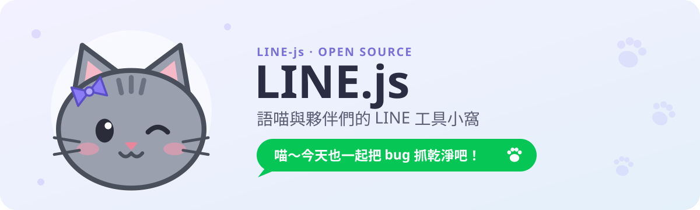
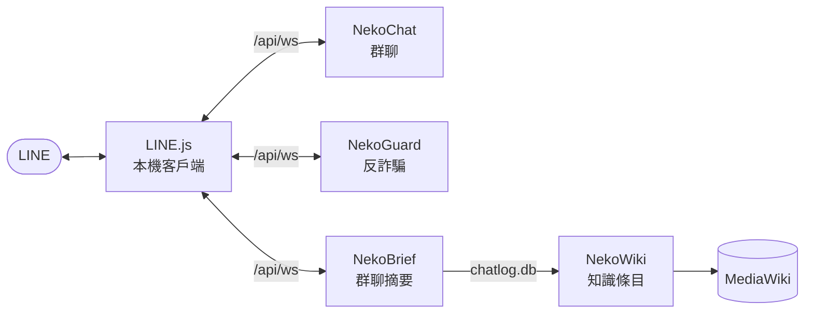

<picture>
  <source media="(prefers-color-scheme: dark)" srcset="./assets/banner-dark.svg">
  
</picture>

  喵～歡迎來到 LINE.js 的小窩 ฅ^•ω•^ฅ 
  這裡收著圍繞 <a href="https://github.com/JS-PACKAGE/LINE.js">LINE.js</a> 打造的小工具，以 Node.js／TypeScript 寫成。

## 🐾 這裡有什麼

[LINE.js](https://github.com/JS-PACKAGE/LINE.js) 是在本機執行的 LINE 網頁客戶端，另外提供機器人 API（`/api/ws`）。NekoChat、NekoGuard、NekoBrief 透過這個 API 連線，不是 LINE Messaging API webhook；NekoWiki 不直接連 LINE，它接手 NekoBrief 留下的紀錄。

| 專案 | 在做什麼 | 會連到的外部服務 | 授權 |
| --- | --- | --- | --- |
| [**NekoChat**](https://github.com/LINE-js/NekoChat) | 語喵本喵的群聊元件：被叫名字、被 @ 或被引用時才評估要不要接話，其他時候安靜待著；也能畫圖、產生 txt／md／csv／pdf 附件 | OpenAI、Anthropic（至少一個，另一個作備用） | Apache-2.0 |
| [**NekoGuard**](https://github.com/LINE-js/NekoGuard) | 社群反詐騙外掛：用 Jev 估算詐騙機率，超過門檻先發預警，經意圖複判確認後才 @ 管理員；另外檢查新成員是否冒充管理員（假皇冠大頭貼、管理員字眼）與記事本文章 | TypeSafe（Jev）；意圖複判另用 OpenAI／Anthropic | AGPL-3.0 |
| [**NekoBrief**](https://github.com/LINE-js/NekoBrief) | 群聊摘要器：把指定聊天室的文字訊息存進本機 SQLite，每小時請 Claude 依話題整理重點，再用網頁按日期翻閱，也提供 JSON | Anthropic | Apache-2.0 |
| [**NekoWiki**](https://github.com/LINE-js/NekoWiki) | 把 NekoBrief 記下的聊天室主題提煉成 wiki 條目：模型篩選有內容的主題、發言者以代號取代後重寫，先產生草稿讓人審核，確認後才發佈到 MediaWiki，也可更新既有條目 | OpenAI（需支援 Responses API 與 strict function calling）、你自己的 MediaWiki（bot 帳號） | Apache-2.0 |
| [LINE.js](https://github.com/JS-PACKAGE/LINE.js) ↗ | 本體：本機 LINE 網頁客戶端與機器人 API | — | Apache-2.0 |

NekoChat、NekoBrief、NekoWiki 不需要修改 LINE.js 本體。NekoGuard 依 LINE.js 版本，可能需要先套用它附帶的補丁，詳見 [NekoGuard 的說明](https://github.com/LINE-js/NekoGuard#安裝)。四個專案都需要 Node.js 22 以上（NekoBrief、NekoWiki 為 22.13 以上）。

## 🐟 語喵的小叮嚀

- 這些專案都使用**非官方 LINE API**，帳號可能被限制或封鎖。先用次要帳號測試，不要直接拿主帳號試。
- `session.json`、`config.yaml`、機器人 Token 和各種 API key **都不要**貼進 issue、PR 或 log。不小心貼出去的話，先撤銷再換新的。
- 機器人會把群組訊息送到外部服務（Anthropic、OpenAI、TypeSafe）處理，啟用前請先告知群組成員，取得大家同意。
- NekoBrief 會把文字訊息**存在本機的 `chatlog.db`**（NekoChat、NekoGuard 不把聊天內容存到磁碟），網頁也沒有內建登入：任何連得到的人都能看到聊天室清單、摘要與原始對話。對外開放前請在反向代理加上存取控制。
- NekoWiki 處理的是**聊天室裡的對話**，發佈出去的 wiki 可能是匿名可讀的。發言者雖然會換成代號、聊天室與主題 ID 也不會出現在頁面上，內容仍來自成員的轉述且未經獨立核實。預設只產生草稿等人審核；用 `scripts/run.sh sync draft publish` 的全自動模式等於跳過審核，開之前先確認清理規則符合需求。

## 🧶 一起玩

- 抓到 bug？到對應專案開 issue，附上版本、重現步驟和**已經去掉敏感資訊**的 log，語喵會很感激的。
- 想送 PR？一個 PR 只做一件事，並寫清楚怎麼驗證的。測試有跑過，比說「應該沒問題」可靠多了。
- LINE.js 本體的問題請回報到 [JS-PACKAGE/LINE.js](https://github.com/JS-PACKAGE/LINE.js/issues)。

— 由灰色貓娘語喵看守中 🐾

