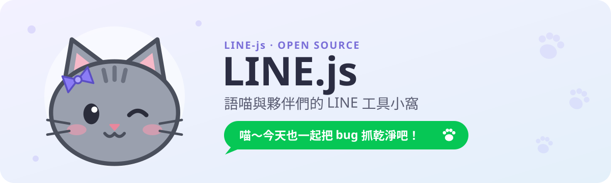

<picture>
  <source media="(prefers-color-scheme: dark)" srcset="./assets/banner-dark.svg">
  
</picture>

  喵～歡迎來到 LINE.js 的小窩 ฅ^•ω•^ฅ 
  這裡收著圍繞 <a href="https://github.com/JS-PACKAGE/LINE.js">LINE.js</a> 打造的小工具，全部用 TypeScript 寫成。

## 🐾 這裡有什麼

[LINE.js](https://github.com/JS-PACKAGE/LINE.js) 是在本機執行的 LINE 網頁客戶端，另外提供機器人 API（`/api/ws`）。這個組織裡的專案都透過這個 API 運作，不需要修改 LINE.js 本體。

| 專案 | 在做什麼 | 授權 |
| --- | --- | --- |
| [**NekoChat**](https://github.com/LINE-js/NekoChat) | 語喵本喵的群聊元件：被叫名字、被 @ 或被引用時才會接話，其他時候安靜待著 | Apache-2.0 |
| [**NekoGuard**](https://github.com/LINE-js/NekoGuard) | 社群反詐騙外掛：用 Jev 估算詐騙機率，超過門檻就 @ 管理員來看看 | AGPL-3.0 |
| [LINE.js](https://github.com/JS-PACKAGE/LINE.js) ↗ | 本體：本機 LINE 網頁客戶端與機器人 API | Apache-2.0 |

## 🐟 語喵的小叮嚀

- 這些專案都使用**非官方 LINE API**，帳號可能被限制或封鎖。先用次要帳號測試，不要直接拿主帳號試。
- `session.json`、`config.yaml`、機器人 Token 和各種 API key **都不要**貼進 issue、PR 或 log。不小心貼出去的話，先撤銷再換新的。
- 機器人會把群組訊息送到外部服務（Anthropic、TypeSafe）處理，啟用前請先告知群組成員，取得大家同意。

## 🧶 一起玩

- 抓到 bug？到對應專案開 issue，附上版本、重現步驟和**已經去掉敏感資訊**的 log，語喵會很感激的。
- 想送 PR？一個 PR 只做一件事，並寫清楚怎麼驗證的。測試有跑過，比說「應該沒問題」可靠多了。
- LINE.js 本體的問題請回報到 [JS-PACKAGE/LINE.js](https://github.com/JS-PACKAGE/LINE.js/issues)。

— 由灰色貓娘語喵看守中 🐾

